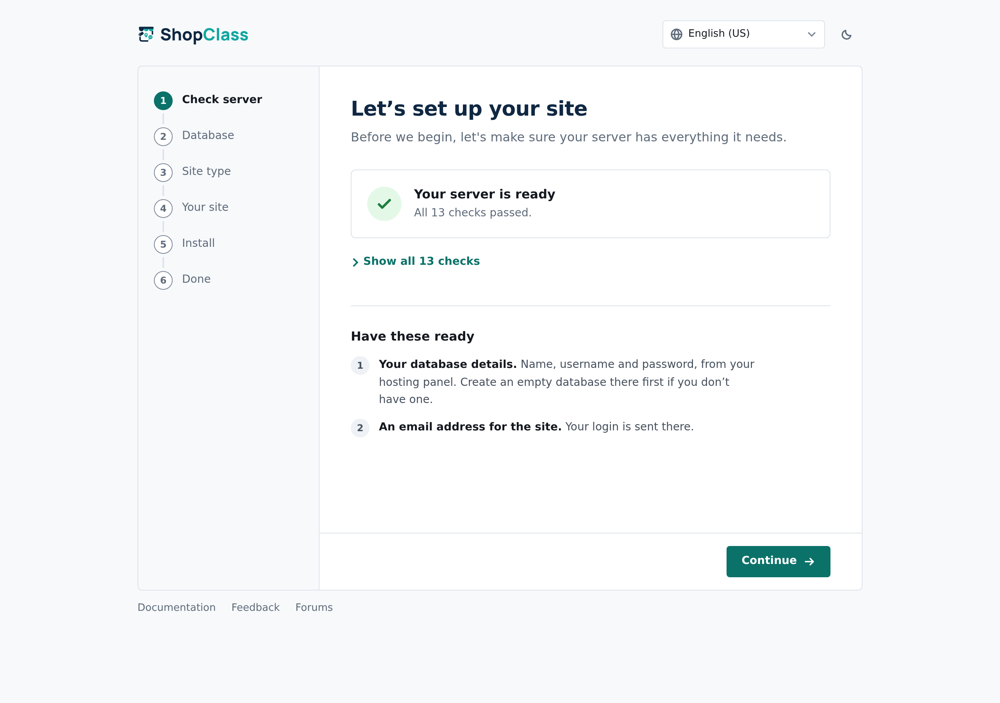
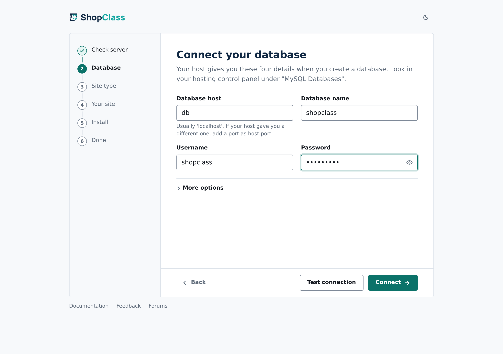
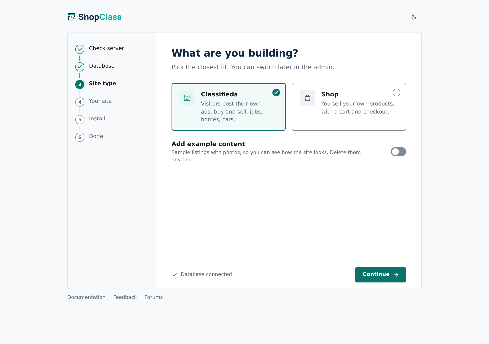
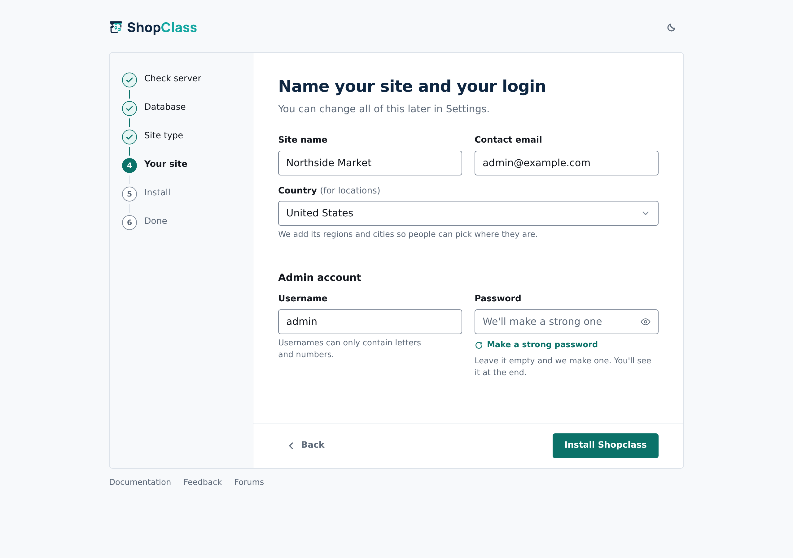
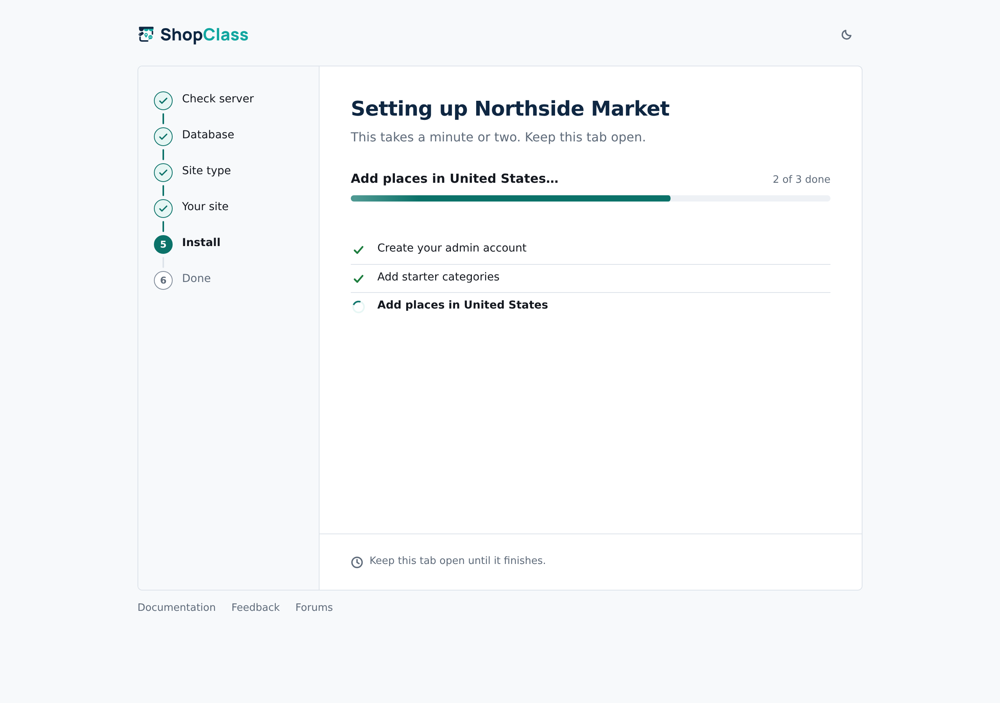
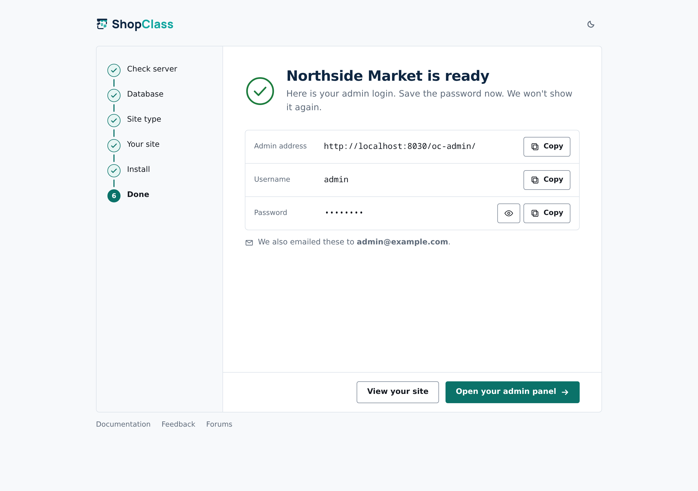

ShopClass installs like most PHP software: upload a release to your web root
(the folder your website serves files from) and open the site in a browser.
There is no build step and no command line needed on the server.

## Server requirements

| Requirement | Minimum |
|---|---|
| PHP | **8.2 or newer** |
| PHP extensions | `mysqli`, `gd`, `curl`, `mbstring`, `openssl`, `zip`, `json`, `ctype`, `fileinfo`, `posix` |
| Database | MySQL 5.7.5+ or MariaDB 10.2+ |
| Web server | Apache or nginx |

Almost every shared host meets this today. If you are not sure, run the
installer anyway. Its first step checks your PHP version, key extensions
(MySQLi, GD and cURL) and your folder permissions, and tells you exactly what
is missing before anything is written.

## 1. Download a release

Download the latest package from the
[**Releases**](https://github.com/mindstellar/shopclass/releases) page.

:::caution[Install from a release, never from a branch]
`master` and `develop` may contain untested code, and they do not carry the
PHP packages and compiled admin files that a release package includes. A site
deployed from a branch will not start.
:::

## 2. Unpack it into your web root

Upload and extract the package into the directory your domain serves, usually
`public_html`, `htdocs` or `/var/www/html`.

You can also install into a subdirectory (`public_html/classifieds`), in which
case your site lives at `https://example.com/classifieds/`.

## 3. Create a database

From your hosting control panel, create an empty MySQL or MariaDB database.
Create a user with full privileges on it too. Write down these four values:
the installer asks for them next:

- database host (usually `localhost`)
- database name
- database user
- database password

If your database listens on a non-default port, enter the host as `host:port`.

## 4. Run the installer

Open your site in a browser (`https://example.com/`) and the installer starts
automatically. If it does not, go straight to
`https://example.com/oc-includes/osclass/install.php`.

The rail at the top shows six steps: **Check server**, **Database**, **Site type**,
**Your site**, **Install** and **Done**.

### Step 1 · Check server

The installer checks your PHP version, the required extensions and folder
write permissions before anything is written. When all is well it says so in one
line. When something fails, it lists only the failures, each with a plain fix you
can do in your hosting panel. Fix them and press **Check again**.



### Step 2 · Database

Enter the details from step 3. **Test connection** checks them without writing
anything. **Connect** checks them, writes `config.php` for you and moves on.
If the connection fails, the error shows above the fields.

Under **More options** you can change the table prefix, have the installer create
the database, or remove the tables of an install that did not finish.



### Step 3 · Site type

Pick **Classifieds** (visitors post their own ads) or **Shop** (you sell your own
products, with a cart and checkout). You can change this later in the admin.

Shop downloads the Aisle theme and the shop plugins you tick, so it needs internet
and package installs turned on. When it cannot be used, the Shop card is greyed out and
the site installs as classifieds.

Tick **Add example content** to start with example listings (or products) and custom
fields. Example photos are downloaded when the site is online; with no internet the
listings install without photos.

While example content is on the site, the top of **Listings** shows a line with a
**Remove sample data** button. It removes the example listings, their photos, fields
and groups; categories stay. The line goes once they are removed.

Either way the site starts with a ready category tree. Classifieds gets Vehicles,
Property, Jobs, Electronics, Home & Garden, Fashion, Baby & Kids, Sports & Hobbies,
Pets, Services, Business & Industrial, Health & Beauty and Community. Shop gets
Clothing, Electronics, Home & Kitchen, Beauty & Health, Sports & Outdoors, Toys & Baby,
Food & Drink, Books & Stationery, Digital Goods and Gifts. Each has subcategories.
Edit them under **Listings → Categories**.



### Step 4 · Your site

Enter the site name, a contact e-mail and your country, then an admin username and
password. Leave the password empty and a strong one is made for you. Press
**Install Shopclass**.



### Step 5 · Install

The installer works through a task list: the admin account, starter categories,
places for your country, the theme, and any example content or shop plugins.
Each task runs on its own, so a slow host does not time out. Keep the tab open
until it finishes.



### Step 6 · Done

Copy the admin password (it is also e-mailed to you) and open the admin panel.
Anything that could not be done, such as a failed download, is listed under
**To finish later** with where to do it in the admin. The site works without it.



## 5. Sign in

Your admin panel is at `https://example.com/oc-admin/`.

The installer only runs once. If the site is already set up it shows a short
notice instead of re-running.

## After installing

A fresh install works, but three things are worth doing on day one:

1. **[Set up cron](/docs/configure/cron/)**: without it, e-mail alerts never
   send and expired listings never expire. The Docker image runs it for you.
2. **[Configure your mail server](/docs/configure/mail-server/)**: registration
   and contact e-mails depend on it.
3. **[Install location data](/docs/configure/locations/)** for the countries you
   serve, so visitors can filter by region and city.

## Installing without a browser

If you deploy from a script or a container image, ShopClass can install itself
from environment variables:

```bash
php oc-cli.php install --unattended
```

Add `--site-type=classifieds|shop` (default `classifieds`) and `--sample-data` to
choose the site type and install the sample data. See the
[command-line interface](/docs/cli/) for the full flag list.

## Troubleshooting

**The installer says a directory is not writable.**
Give the web-server user write access to the paths it names, typically
`oc-content/` and its `uploads/` and `downloads/` subdirectories. On most hosts
`755` on directories is enough; `777` is almost never necessary and is worth
avoiding.

**"Allowed memory size of X bytes exhausted".**
See [increase the PHP memory limit](/docs/configure/memory-limit/).

**What the `.htaccess` holds.** Core writes the friendly-URL rules, then compression
(`mod_deflate`) and browser cache times for static files (`mod_headers`: CSS and JavaScript an
hour, images and fonts a week). Each block is skipped when its module is missing. An older
file core wrote is updated on upgrade; a file you edited is left alone.

**The site loads but every link 404s.**
Your web server is not rewriting URLs. On Apache, confirm `mod_rewrite` is
enabled and that `AllowOverride All` applies to your web root so the shipped
`.htaccess` is read. On nginx, add the `try_files` rule from the
[repository's reference config](https://github.com/mindstellar/shopclass).

**Something else.**
Ask in [GitHub Discussions](https://github.com/mindstellar/shopclass/discussions).
Include your PHP version, your host, and what the screen actually said.
